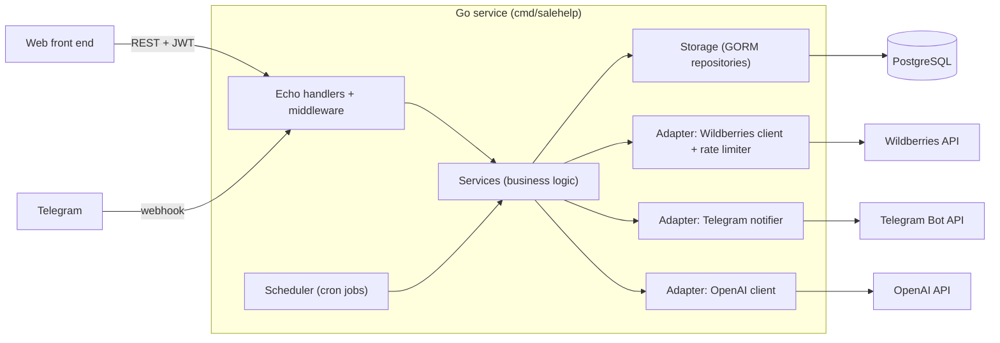

# SaleHelp (Accellero)

[](https://github.com/AntonRussinov/SaleHelp-public/actions/workflows/ci.yml)

**English** | [Русский](README.ru.md)

SaleHelp is a Go backend for Wildberries marketplace sellers. It periodically syncs shop data
(orders, products, prices, stock, feedback) from the Wildberries API, detects changes, and pushes
notifications to a Telegram bot. It also generates AI replies to customer feedback, manages
subscriptions and quotas, and exposes a JWT-protected REST API for a web front end.

> The repository is published for demonstration purposes. See [LICENSE](LICENSE) (all rights reserved).
> User-facing texts (Telegram bot, API descriptions) are in Russian because the product targets Russian-speaking sellers.

## Features

- **Wildberries sync** - several shops per account; orders (FBS/DBW/DBS), products and sizes, warehouses,
  price and stock snapshots, feedback and questions, daily sales and refusals. Basic and service WB tokens use different rate-limit policies.
- **Telegram bot** - webhook-based (`POST /telegram/webhook`, optional secret header); shop onboarding,
  shop and chat management, invite links, `/orders`, `/alerts`, `/abc_now`, answering WB questions from the chat.
- **Alerts** - rules per shop (`price_drop`, `stock_low`, `stock_zero`) evaluated against stored snapshots,
  with deduplicated delivery to Telegram chats and per-event notification settings.
- **Digests and analytics** - daily sales digest, refusal digest, stock replenishment hints, weekly/monthly ABC analysis.
- **Price restore** - restore prices after a drop through a status machine (`pending -> restoring -> restored | failed`).
- **AI replies to feedback** - OpenAI-based generation with models chosen by star rating, per-shop tone/brand
  settings and rules, text sanitizing, monthly quota; generation and sending to WB are separate scheduled jobs.
- **Subscriptions** - plans, add-on packages, access levels and limits, expiry notifications, monthly AI quota reset.
- **Auth** - Google sign-in (`id_token`) and email/password; JWT issued by the service; Telegram account linking;
  role-based access rules (Casbin).
- **Scheduler** - cron jobs (robfig/cron) with a DB lease per shop so several instances do not sync the same shop.

## Architecture



Dependencies are wired by hand in [internal/app/di](internal/app/di) (`Provider`), without a DI framework.
`domain/` holds entities and errors and does not depend on infrastructure.

## Tech stack

Versions are taken from [go.mod](go.mod).

| Area | Technology |
|------|-----------|
| Language | Go 1.24.4 |
| HTTP | Echo v4.15.0, echo-swagger v1.4.1 (swag v1.8.12) |
| Database | PostgreSQL (16 in docker-compose), GORM v1.30.0, pgx v5.7.2 |
| Migrations | [goose](https://github.com/pressly/goose) (SQL files in `db/migrations`) |
| Scheduling | robfig/cron v3.0.1 |
| Config | Viper v1.19.0 (YAML) + environment overrides |
| Auth | golang-jwt v5.3.1, Google API client, Casbin v2.98.0 |
| AI | OpenAI via langchaingo v0.1.14 |
| Rate limiting | golang.org/x/time v0.14.0 (token bucket) |
| Testing | testify v1.11.1, go-sqlmock v1.5.2, mockery |
| Tooling | golangci-lint, Docker, GitHub Actions |

## Quick start

Prerequisites: Go 1.24+, Docker with Compose, [goose](https://github.com/pressly/goose)
(`go install github.com/pressly/goose/v3/cmd/goose@latest`).

```bash
# 1. PostgreSQL (user/password/db: salehelp)
make compose

# 2. Schema
make migrate-up

# 3. Configuration
cp configs/config.example.yml configs/config.yml
# optional secrets via env (the app does not read .env files itself)
cp .env.example .env && set -a && source .env && set +a

# 4. Run
make run
```

The server listens on `service.listen` (`:8080` in the example). Outside `production`, Swagger UI is served at
`http://localhost:8080/swagger/index.html`. Run `make help` for all targets.

## Configuration

Settings are read in [internal/config/config.go](internal/config/config.go) from a YAML file
(`-c` / `--config`, default `configs/config.yml`). A fixed set of environment variables then overrides
file values. The full list of keys with placeholder values is in
[configs/config.example.yml](configs/config.example.yml); `.env.example` lists the environment variables.

| Environment variable | Overrides / purpose |
|----------------------|---------------------|
| `DATABASE_URL` | `service.db.connstring` (PostgreSQL DSN); also used by `make migrate-*` |
| `TELEGRAM_BOT_TOKEN` | `service.telegramtoken` |
| `JWT_SECRET` | `service.jwt_secret`; without it the `/auth/*` routes are not registered |
| `GOOGLE_CLIENT_ID` | `service.google_auth.client_id` (fallback when not set in the file) |
| `OPENAI_API_KEY` | `service.ai.api_key`; without a key AI replies are disabled |
| `WB_X_CLIENT_SECRET` | `service.wb_x_client_secret` (sent as `X-Client-Secret` when set) |

Cron expressions for every job live under `service.scheduler` and `service.abc_analysis`; a few have
built-in defaults in [internal/app/di/sheduller.go](internal/app/di/sheduller.go).

## API documentation

OpenAPI 2.0 spec is generated by swag from handler annotations and committed in [docs/](docs)
(`swagger.json`, `swagger.yaml`). Regenerate with `make swagger`. The UI is mounted at `/swagger/*` when
`service.environment` is not `production`. Protected endpoints use a `Authorization: Bearer <JWT>` header.

## Project structure

```text
cmd/salehelp/          entry point (config, graceful shutdown)
cmd/swagger/           swag annotations entry point
api/                   public request/response types
domain/                entities, domain errors
internal/app/          application lifecycle; app/di - manual dependency wiring, routes
internal/config/       Viper-based configuration
internal/handler/      Echo handlers per resource
internal/middleware/   JWT/admin auth, pagination, cursor, filters, ordering
internal/services/     business logic (monitoring, alert, ai_reply, subscription, telegrambot, ...)
internal/storage/      GORM repositories (pggorm/repository/*)
internal/adapter/      wb (client, DTOs, mappers, rate limiter), telegram, ai
internal/scheduler/    cron runner and jobs
internal/access/       Casbin-based access manager
pkg/                   reusable packages: ai, auth, logger, notify, validator, ...
db/migrations/         goose SQL migrations
mocks/                 mockery-generated mocks
test/                  test helpers (sqlmock helpers, echo testing)
minikube/              local Kubernetes manifests for PostgreSQL
```

## Testing and linting

```bash
make test       # go test -v ./...
make race       # with the race detector
make coverage   # coverage.out + HTML report for ./internal/...
make lint       # golangci-lint, configuration in .golangci.yml (enable-all with exclusions)
```

Repository tests run against `go-sqlmock`, so no database is needed to run the test suite.
CI ([.github/workflows/ci.yml](.github/workflows/ci.yml)) runs build, vet, `go test -race` and golangci-lint (new issues only).

## Design notes

- **Rate limits per API category.** [rate_limiter.go](internal/adapter/wb/client/rate_limiter.go) keeps token buckets per
  API key and per Wildberries API category (content, marketplace, prices, statistics, feedbacks, ...), with separate
  policies for basic and service tokens. Write-type categories are marked `PersistAcrossSync`, so
  re-registering a key on each sync does not reset their budget.
- **Idempotent writes.** Orders, sales, refusals and questions are inserted with `ON CONFLICT ... DO NOTHING`
  or upserts, so repeated syncs are safe. Triggered alerts are deduplicated on
  `(alert_id, product_id, snapshot_id, product_size_key)`.
- **Multi-instance safety.** Per-shop sync takes a lease in `shop_sync_leases` using a single
  `INSERT ... ON CONFLICT DO UPDATE ... WHERE lease_until < now()` statement; an instance that does not win the lease skips the shop.
- **Layered architecture with explicit wiring.** Handlers -> services -> repositories, with interfaces declared on
  the consumer side (for example `ShopLeaseLocker`, `MonitoringService` in the sync job), which keeps jobs and services testable.
- **Decoupled AI generation and delivery.** Replies are generated and stored by one job and sent to Wildberries by another,
  so a delivery failure or WB rate limit does not lose the generated text. Token usage and estimated cost are tracked per reply.
- **Background work and shutdown.** Cron jobs run on a worker pool with per-shop timeouts; the notifier worker runs in
  its own goroutine, and `main` performs graceful HTTP and scheduler shutdown on SIGINT/SIGTERM.

## License

All rights reserved. The code is published for demonstration only; see [LICENSE](LICENSE).
